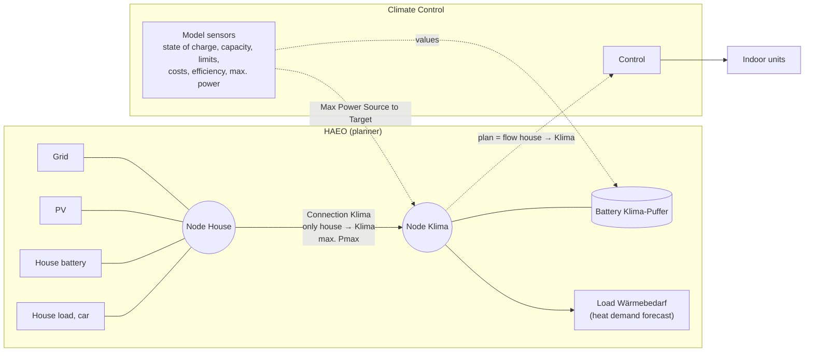
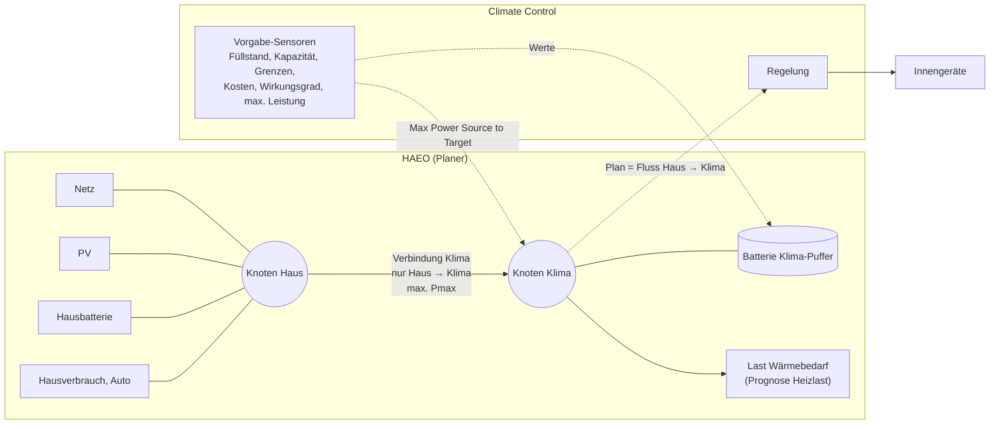

# Climate Control

**English** · [Deutsch](#deutsch)

> [!WARNING]
> **Alpha version.** Climate Control is in an early stage and under active development. Breaking changes are not ruled out: settings,
> entities and behavior may change between releases (a stored configuration is migrated where possible, but not always without
> adjustments). Use it only if you can watch your plant and check the planner values after each update.

Home Assistant integration (HACS) that makes a multi-split air conditioner usable as a thermal buffer for an
energy planner (reference: HAEO). The integration does not plan anything itself:

- It provides the planner with the buffer model (state of charge from the device temperatures, capacity,
  limits, costs, power).
- The planner decides when and with how much power to heat, e.g. directly with PV surplus during the day or
  at low prices at night instead of taking the detour via a battery.
- The integration executes this plan on the installation: it selects indoor units, modes and setpoints,
  protects the rooms (frost protection, overheating, open window). Without a plan it waits 10 minutes, then falls back
  to normal heating, switching the units on step by step.

Status: all decided requirements implemented and tested (unit, integration, e2e against Home Assistant
2026.10.2). Functional specification: `docs/spec/functional/`, technical: `docs/spec/technical/`.
Way of working: `AGENTS.md`.

## Setup order

Climate Control needs the plan from the planner, and the planner needs the sensors of Climate Control.
Therefore set up in this order:

1. **Install** via HACS (first button above), restart Home Assistant.
2. **Create the installation** – *Settings → Devices & services → Add integration → Climate Control*
   (or the second button above): name, Pmin, Pmax, the power sensor of the outdoor unit (mandatory) and, optionally, the cooling switch.
   **Leave the planner sensor empty.**
   Without a planner sensor the installation is in commissioning mode: it publishes all sensors but sends
   **no command to the indoor units** (no fallback either).
3. **Add indoor units** – in the three-dot menu (⋮) of the installation entry, *"Add indoor unit"* once per
   unit: climate entity, room name,
   setpoint (fixed value, optionally an entity such as a number helper; the fixed value is then the substitute),
   optional control range and absolute limit around the setpoint (default 2 / 3 in the unit of the plant, below and above),
   nominal power (units with equal nominal power form a power class), area, optional window contacts (one or
   more, the room counts as open as soon as one is open). Units can
   be changed or removed one by one. Each indoor unit gets its own device with diagnostic sensors (see below).
4. **Set up HAEO** with the sensors of Climate Control, see [Connecting HAEO](#connecting-haeo).
5. **Connect the plan** – *Configure → Planner output (planned power)* and select the HAEO sensor with the planned power
   (`sensor.<connection>_source_to_target_power`, e.g. `sensor.connection_klima_standard_source_to_target_power`;
   HAEO 0.4.1 shows it as "Connection … {source} to {target} power", search for the connection name).
   With two power stages select both connections. From now on Climate Control follows the plan.
6. Optional: **Configure** opens a menu of parameter groups: control, state of charge, protection and fallback,
   planner model.

Above every non-trivial field there is a collapsible **"Help: …"** section explaining the field. The switch
**"Expand help texts when opening"** inside it decides whether all help texts are expanded the next time the
settings are opened. Several installations can be set up side by side.

**Temperature unit.** Celsius is the default. Choose Fahrenheit in the installation if your air conditioners report °F: device temperatures and setpoints are then °F. All distances (control range, absolute limit, SOC scale, offset, band, thresholds) are numbers in the unit of the plant with the same start values: 1 K becomes 1 °C or 1 °F. Setpoints already entered are not converted when the unit is changed.

**Load control.** The outdoor unit's power follows the requested power by moving the setpoints of the indoor units in power steps (optional per unit, default 0.5 in the unit of the plant). It reacts to temperature changes of the served units, not to fixed time windows. A step moves two units, one of the largest and one of the smallest power class; setpoints first, then more units. Nothing is adjusted within a dead band of 10 % of Pmin, and the plant never runs below two power steps. The power per step is learned per indoor unit from the settled outdoor power (diagnostic sensor *Power per step* on each indoor unit); until then (Pmax − Pmin) / (2 × number of units) applies. Concept: `docs/spec/technical/60-load-control.md`.

**Heating or cooling.** The plant heats by default. An optional switch (switch, binary sensor or input boolean) in the
installation selects cooling: off = heating, on = cooling; without the entity, or while it is unavailable, the plant heats.
Cooling mirrors everything: the buffer is a cold store (SOC 30 °C = 0 %, 15 °C = 100 %), the units cool, and the limits
sent to the planner are mirrored around each setpoint. Changing the mode first puts all units in the neutral mode.

**Buffer capacity.** It is not a setting. It starts at 3 kWh_el/K and is learned from operation: the electrical energy of the
outdoor unit (the mandatory power sensor) per change of the area-weighted mean device temperature, in windows of at least
0.35 K, separately for heating and cooling. Nothing else is used, in particular no load forecast. The learned values are
diagnostic sensors (*Learned capacity heating / cooling*, read-only) and survive restarts. Only after fundamental changes to
the plant the service `climate_control.reset_learned_capacity` sets them back to the start value; it is not offered in daily use.
Concept: `docs/spec/technical/50-capacity-learning.md`.

### Diagnostic sensors per indoor unit

| Sensor | Meaning |
| --- | --- |
| Deviation from setpoint (K) | setpoint minus device temperature; positive = room too cold |
| Heat demand (kWh_el) | electrical energy up to the setpoint; negative = energy stored above the setpoint |
| Storage capacity (kWh_el) | electrical energy the room can still take up to its absolute limit |

The energy values split the buffer capacity among the rooms by area (assumption).

## Connecting HAEO

The integration does not configure HAEO. It provides sensors that the HAEO elements refer to and reads the
plan back from HAEO. HAEO is set up by hand.

> Field names as in HAEO 0.4.1 (checked on 23 Oct 2026). HAEO 0.5 changes the battery (e.g. "Limit cost" instead of
> partitions); this guide does not cover 0.5 yet.

### Target topology

- The **battery Klima-Puffer** is the virtual heat store; its state of charge is the SOC of the worst room.
- The **load Wärmebedarf** represents the rooms cooling down. Its forecast (electrical equivalent of the heat
  demand from the weather forecast) is the planner's job and not part of this integration. Without this load
  HAEO only sees the measured SOC and keeps it constant for the future; cooling down is then not planned ahead
  but only noticed afterwards as a lower SOC.
- Battery and load hang on their own **node Klima**. Power only flows from the house to Klima (reverse 0).
  The battery can discharge into the load but cannot feed power into the house, which is physically impossible.
- **Plan:** Climate Control reads the planned **flow house → Klima**. It covers both charging the buffer and
  heating directly into the load; the battery's charge power alone would miss the direct part.

### Steps in HAEO

1. Enable **Advanced Mode** in the HAEO hub (needed for connections).
2. Create a **number helper** (`input_number`) for each fixed value: `0` (reverse direction) and `100`
   (discharge efficiency). HAEO expects helpers for constants.
3. Create **node** `Klima` (neither source nor sink).
4. Create **battery** `Klima-Puffer`: *Connection* = `Klima`, *Configure battery partitions* on,
   all fields as in the table below.
5. Create **load** `Wärmebedarf`: *Connection* = `Klima`, *Forecast* = sensor of the expected heat demand in kW
   (electrical).
6. Create **connection** `Klima`: *Source Device* = house node, *Target Device* = `Klima`, fields as in the table.
7. Continue with step 5 of the [setup order](#setup-order).

**Optional, two power stages:** if HAEO should use the upper, less efficient power range only when it pays off,
replace connection `Klima` by two connections from the house node to `Klima`, e.g. `Klima Stufe 1` and
`Klima Stufe 2`. Their limits and the surcharge of stage 2 are pure HAEO settings (number helpers); Climate
Control does not care which stage the power comes from. Select both connection sensors as planned power in
Climate Control, they are added up.

### Sensor mapping

Every sensor that feeds a HAEO field carries the name of that field. In the entity picker it appears as
**"&lt;installation name&gt; &lt;field name&gt;"**, e.g. *Climate Control Haus Min Charge Level*. Field names below
are those of HAEO 0.4.1 (HAEO is English only). Lower and upper limits form pairs:
*Min/Max Charge Level*, *Undercharge/Overcharge percentage*, *Undercharge/Overcharge cost*.

| HAEO element | HAEO field | Choose in the picker | Meaning |
| --- | --- | --- | --- |
| Battery | Capacity | *&lt;installation&gt;* Capacity | buffer capacity, kWh |
| Battery | State of Charge | *&lt;installation&gt;* State of Charge | SOC of the worst room |
| Battery | Min Charge Level | *&lt;installation&gt;* Min Charge Level | area-weighted lower end of the control ranges, lowered at night, forecast |
| Battery | Max Charge Level | *&lt;installation&gt;* Max Charge Level | area-weighted upper end of the control ranges |
| Battery | Charge efficiency | *&lt;installation&gt;* Charge efficiency | buffer efficiency |
| Battery | Discharge efficiency | helper `100` | – |
| Battery | Max discharge power | *&lt;installation&gt;* Max discharge power | buffer discharge limit |
| Battery | Max charge power | leave empty | limited by the connection |
| Battery | Charge cost | *&lt;installation&gt;* Charge cost | late charge surcharge, falls over the horizon, forecast |
| Battery partitions | Undercharge percentage | *&lt;installation&gt;* Undercharge percentage | area-weighted absolute limit below the setpoint, lowered at night, forecast |
| Battery partitions | Undercharge cost | *&lt;installation&gt;* Undercharge cost | penalty between control range and absolute limit |
| Battery partitions | Overcharge percentage | *&lt;installation&gt;* Overcharge percentage | area-weighted absolute limit above the setpoint |
| Battery partitions | Overcharge cost | *&lt;installation&gt;* Overcharge cost | overload surcharge |
| Connection Klima | Max Power Source to Target | *&lt;installation&gt;* Max Power Source to Target | Pmax |
| Connection Klima | Max Power Target to Source | helper `0` | no feed-in into the house |

The other Climate Control sensors are for the user: *Planned power*, *Requested power*, *Running*,
*Fallback*, and per indoor unit *Deviation from setpoint*, *Heat demand*, *Storage capacity*.

The efficiency parameter (default 92 %) is used as charge efficiency here; the discharge efficiency stays at
100 % so that the overall efficiency equals the parameter.

**Updating from version 0.2 or older:** the display names changed to the HAEO field names; entity IDs that
already exist stay the same, so selections already made in HAEO keep working.

### Forecasts

The sensors *Min Charge Level*, *Undercharge percentage* and *Charge cost* carry a `forecast` attribute as a list of
`{time, value}` with ISO 8601 timestamps. This is the custom format documented by HAEO for input sensors
(also used by e.g. template forecasts). Notes from the HAEO documentation:

- If a forecast ends before the HAEO horizon, HAEO repeats it in daily periods. Set the parameter
  **Planner forecast horizon** at least as long as the HAEO horizon, otherwise the falling late charge
  surcharge starts over after 24 h.
- HAEO averages between forecast points; the step of the night setback is therefore slightly smoothed.
- *Current Charge Percentage* only uses the current value (scalar field in HAEO).

The forecasts are part of the current state that HAEO reads; they are only excluded from the recorder
database (history) to keep it small.

### Still to check

- Checked on 23 Oct 2026: HAEO 0.4.1 connection sensors deliver kW with a `forecast` list of `{time, value}`
  (time zone included, steps of 1 min to 1 h); Climate Control reads them as they are.
- Whether HAEO accepts the currency unit of the cost sensors (`<currency>/kWh`); the unit must match the field.
- After step 5: the Climate Control sensor *Planned power* shows the planned flow house → Klima and the coming
  hours in its `forecast` attribute; binary sensor *Fallback* is off.

## Development

1. Open the folder in VS Code, choose "Reopen in Container" (Docker required).
2. `docker compose -f .devcontainer/docker-compose.yml up -d homeassistant` (the dev container does this itself).
3. `pytest tests/unit tests/integration`, `pytest tests/performance -s`, `pytest tests/e2e`,
   then `python scripts/check_traceability.py`.
4. Regenerate: `docs/REGENERATION.md`.

---

# Climate Control (Deutsch)

[English](#climate-control) · **Deutsch**

> [!WARNING]
> **Alpha-Version.** Climate Control befindet sich in einem frühen Stadium und wird aktiv weiterentwickelt. Breaking Changes sind nicht
> ausgeschlossen: Einstellungen, Entitäten und Verhalten können sich zwischen Releases ändern (eine gespeicherte Konfiguration wird,
> soweit möglich, migriert, aber nicht immer ohne Nacharbeit). Nur einsetzen, wenn du deine Anlage beobachten und nach jedem Update die
> Werte für den Planer prüfen kannst.

Home-Assistant-Integration (HACS), die eine Klimaanlage mit mehreren Innengeräten für einen Energie-Planer
(Referenz: HAEO) als thermischen Puffer nutzbar macht. Die Integration plant selbst nichts:

- Sie liefert dem Planer das Modell des Puffers (Füllstand aus der Gerätetemperatur, Kapazität, Grenzen,
  Kosten, Leistung).
- Der Planer entscheidet, wann und mit welcher Leistung geheizt wird, z. B. direkt mit PV-Überschuss am Tag
  oder bei günstigen Preisen nachts statt über den Umweg Batteriespeicher.
- Die Integration setzt diesen Plan an der Anlage um: Sie wählt Innengeräte, Betriebsmodi und Sollwerte,
  schützt die Räume (Frostschutz, Überhitzung, offenes Fenster). Ohne Plan wartet sie 10 Minuten und fällt dann auf
  normales Heizen zurück, wobei die Geräte schrittweise eingeschaltet werden.

Status: alle beschlossenen Anforderungen umgesetzt und getestet (unit, integration, e2e gegen Home Assistant
2026.10.2). Fachliche Spezifikation: `docs/spec/functional/`, technische: `docs/spec/technical/`.
Arbeitsweise: `AGENTS.md`.

## Reihenfolge der Einrichtung

Climate Control braucht den Plan aus dem Planer, und der Planer braucht die Sensoren von Climate Control.
Deshalb in dieser Reihenfolge einrichten:

1. **Installieren** über HACS (erste Schaltfläche oben), Home Assistant neu starten.
2. **Anlage anlegen** – *Einstellungen → Geräte & Dienste → Integration hinzufügen → Climate Control*
   (oder zweite Schaltfläche oben): Name, Pmin, Pmax, der Leistungssensor des Außengeräts (Pflicht) und optional der Kühlen-Schalter.
   **Planer-Sensor leer lassen.**
   Ohne Planer-Sensor ist die Anlage in Inbetriebnahme: Sie stellt alle Sensoren bereit, schickt aber
   **keinen Befehl an die Innengeräte** (auch keinen Rückfall).
3. **Innengeräte hinzufügen** – im Drei-Punkte-Menü (⋮) des Anlagen-Eintrags *„Innengerät hinzufügen“*, je Gerät
   einmal: Klimagerät,
   Raumname, Sollwert (fester Wert oder zusätzlich eine Entität wie ein Zahl-Helfer, dann ist der feste Wert der
   Ersatzwert), optional Regelbereich und absolute Grenze um den Sollwert (Standard 2 / 3 in der Einheit der Anlage, unten und oben),
   Nennleistung (Geräte gleicher Nennleistung bilden eine Leistungsklasse), Fläche, optional Fensterkontakte
   (einer oder mehrere, der Raum gilt als offen, sobald einer offen ist).
   Jedes Innengerät erhält ein eigenes Gerät mit Diagnose-Sensoren (siehe unten). Innengeräte lassen sich später
   einzeln ändern oder löschen.
4. **HAEO einrichten** mit den Sensoren von Climate Control, siehe [HAEO anbinden](#haeo-anbinden).
5. **Plan verbinden** – *Konfigurieren → Planer-Ausgabe (geplante Leistung)* und den HAEO-Sensor mit der geplanten Leistung wählen
   (`sensor.<verbindung>_source_to_target_power`, z. B. `sensor.connection_klima_standard_source_to_target_power`;
   HAEO 0.4.1 zeigt ihn als „Connection … {source} to {target} power“, nach dem Verbindungsnamen suchen).
   Bei zwei Leistungsstufen beide Verbindungen wählen. Ab jetzt folgt Climate Control dem Plan.
6. Optional: **Konfigurieren** öffnet ein Menü mit Parametergruppen: Regelung, Füllstand, Schutz und Rückfall,
   Planer-Modell.

Über jedem nicht trivialen Feld steht ein einklappbarer Abschnitt **„Hilfe: …“** mit der Erklärung des
Feldes. Der Schalter **„Hilfetexte beim Öffnen aufgeklappt“** im Abschnitt legt fest, ob alle Hilfetexte
beim nächsten Öffnen auf- oder zugeklappt sind. Mehrere Anlagen können nebeneinander eingerichtet werden.

**Temperatureinheit.** Standard ist Celsius. Melden deine Klimageräte °F, wähle in der Anlage Fahrenheit: Alle Temperaturen der Geräte (Gerätetemperaturen und Sollwerte) sind dann °F. Alle Abstände (Regelbereich, absolute Grenze, SOC-Skala, Offset, Band, Schwellen) sind Zahlen in der Einheit der Anlage mit denselben Startwerten: Aus 1 K wird 1 °C bzw. 1 °F. Bereits eingegebene Sollwerte werden beim Wechsel der Einheit nicht umgerechnet.

**Lastregelung.** Die Leistung des Außengeräts folgt der angeforderten Leistung, indem die Sollwerte der Innengeräte in Leistungsschritten verstellt werden (optional je Gerät, Standard 0,5 in der Einheit der Anlage). Sie reagiert auf Temperaturänderungen der bedienten Geräte, nicht auf feste Zeitfenster. Ein Schritt verstellt zwei Geräte, eines der größten und eines der kleinsten Leistungsklasse, erst die Sollwerte, dann weitere Geräte. Innerhalb eines Totbands von 10 % von Pmin wird nichts verstellt, und die Anlage läuft nie unter zwei Leistungsschritten. Die Leistung je Schritt wird je Innengerät aus der beruhigten Außenleistung gelernt (Diagnose-Sensor *Leistung je Schritt* am Innengerät), bis dahin gilt (Pmax − Pmin) / (2 × Zahl der Geräte). Konzept: `docs/spec/technical/60-load-control.md`.

**Heizen oder Kühlen.** Standard ist Heizen. Ein optionaler Schalter (Schalter, Binärsensor oder Ein/Aus-Helfer) in der
Anlage wählt das Kühlen: aus = Heizen, ein = Kühlen; ohne Entität oder solange sie nicht verfügbar ist, wird geheizt.
Das Kühlen spiegelt alles: Der Puffer ist ein Kältespeicher (SOC 30 °C = 0 %, 15 °C = 100 %), die Geräte kühlen, und die
Grenzen für den Planer werden um den jeweiligen Sollwert gespiegelt. Beim Wechsel gehen zuerst alle Geräte in den neutralen Modus.

**Pufferkapazität.** Sie ist keine Einstellung. Sie startet mit 3 kWh_el/K und wird im Betrieb gelernt: elektrische Energie
des Außengeräts (der Pflicht-Leistungssensor) je Änderung der flächengewichteten mittleren Gerätetemperatur, in Fenstern von
mindestens 0,35 K, getrennt für Heizen und Kühlen. Sonst nichts, insbesondere keine Lastprognose. Die gelernten Werte sind
Diagnose-Sensoren (*Gelernte Kapazität Heizen / Kühlen*, nur lesbar) und bleiben über Neustarts erhalten. Nur nach grundlegenden
Änderungen an der Anlage setzt der Dienst `climate_control.reset_learned_capacity` sie auf den Startwert zurück; er wird im
Alltag nicht angeboten. Konzept: `docs/spec/technical/50-capacity-learning.md`.

### Diagnose-Sensoren je Innengerät

| Sensor | Bedeutung |
| --- | --- |
| Abweichung zum Sollwert (K) | Sollwert minus Gerätetemperatur; positiv = Raum zu kalt |
| Wärmebedarf (kWh_el) | elektrische Energie bis zum Sollwert; negativ = über dem Sollwert gespeicherte Energie |
| Speicherkapazität (kWh_el) | elektrische Energie, die der Raum bis zu seiner absoluten Grenze noch aufnehmen kann |

Die Energiewerte teilen die Pufferkapazität nach Fläche auf die Räume auf (Annahme).

## HAEO anbinden

Die Integration konfiguriert HAEO nicht selbst. Sie stellt Sensoren bereit, auf die die HAEO-Elemente
verweisen, und liest den Plan aus HAEO zurück. Die Einrichtung in HAEO erfolgt von Hand.

> Feldnamen wie in HAEO 0.4.1 (geprüft am 23.10.2026). HAEO 0.5 baut die Batterie um (z. B. „Limit cost“ statt
> Partitionen); diese Anleitung deckt 0.5 noch nicht ab.

### Zielbild der Topologie

- Die **Batterie Klima-Puffer** ist der virtuelle Wärmespeicher; ihr Füllstand ist der SOC aus dem
  schlechtesten Raum.
- Die **Last Wärmebedarf** bildet die Auskühlung der Räume ab. Ihre Prognose (elektrisches Äquivalent der
  Heizlast aus der Wetterprognose) ist Sache des Planers und nicht Teil dieser Integration. Ohne diese Last
  sieht HAEO nur den gemessenen SOC und hält ihn für die Zukunft konstant; die Auskühlung wird dann nicht
  vorausgeplant, sondern erst nachträglich am gesunkenen SOC sichtbar.
- Batterie und Last hängen am eigenen **Knoten Klima**. Strom fließt nur vom Haus zum Klima (Rückrichtung 0).
  Die Batterie kann sich so in die Last entladen, aber keinen Strom ins Haus speisen, was physikalisch auch
  nicht geht.
- **Plan:** Climate Control liest den geplanten **Fluss Haus → Klima**. Er umfasst Laden des Puffers und
  direktes Heizen in die Last; die Ladeleistung der Batterie allein würde den direkten Anteil nicht enthalten.

### Schritte in HAEO

1. Im HAEO-Hub den **Advanced Mode** einschalten (nötig für Verbindungen).
2. Für feste Werte je einen **Helfer „Zahl“** (`input_number`) anlegen: `0` (Rückrichtung) und `100`
   (Entlade-Wirkungsgrad). HAEO erwartet für Konstanten Helfer.
3. **Knoten** `Klima` anlegen (weder Quelle noch Senke).
4. **Batterie** `Klima-Puffer` anlegen: *Connection* = `Klima`, *Configure battery partitions* an,
   alle Felder laut Tabelle unten.
5. **Last** `Wärmebedarf` anlegen: *Connection* = `Klima`, *Forecast* = Sensor der erwarteten Heizlast in kW
   (elektrisch).
6. **Verbindung** `Klima` anlegen: *Source Device* = Hausknoten, *Target Device* = `Klima`, Felder laut Tabelle.
7. Weiter mit Schritt 5 der [Reihenfolge der Einrichtung](#reihenfolge-der-einrichtung).

**Optional, zwei Leistungsstufen:** Soll HAEO den oberen, weniger effizienten Leistungsbereich nur nutzen,
wenn es sich lohnt, die Verbindung `Klima` durch zwei Verbindungen vom Hausknoten zu `Klima` ersetzen, z. B.
`Klima Stufe 1` und `Klima Stufe 2`. Deren Grenzen und der Aufschlag der Stufe 2 sind reine HAEO-Einstellungen
(Zahl-Helfer); Climate Control ist egal, aus welcher Stufe die Leistung kommt. In Climate Control beide
Verbindungssensoren als geplante Leistung wählen, sie werden addiert.

### Zuordnung der Sensoren

Jeder Sensor, der ein HAEO-Feld befüllt, trägt den Namen dieses Felds. In der Entitätsauswahl erscheint er als
**„&lt;Name der Anlage&gt; &lt;Feldname&gt;“**, z. B. *Climate Control Haus Min Charge Level*. Die Feldnamen unten
sind die von HAEO 0.4.1 (HAEO gibt es nur auf Englisch). Untere und obere Grenzen bilden Paare:
*Min/Max Charge Level*, *Undercharge/Overcharge percentage*, *Undercharge/Overcharge cost*.

| HAEO-Element | HAEO-Feld | In der Auswahl wählen | Bedeutung |
| --- | --- | --- | --- |
| Batterie | Capacity | *&lt;Anlage&gt;* Capacity | Pufferkapazität, kWh |
| Batterie | State of Charge | *&lt;Anlage&gt;* State of Charge | Füllstand des schlechtesten Raums |
| Batterie | Min Charge Level | *&lt;Anlage&gt;* Min Charge Level | flächengewichtetes unteres Ende der Regelbereiche, nachts abgesenkt, Prognose |
| Batterie | Max Charge Level | *&lt;Anlage&gt;* Max Charge Level | flächengewichtetes oberes Ende der Regelbereiche |
| Batterie | Charge efficiency | *&lt;Anlage&gt;* Charge efficiency | Wirkungsgrad des Puffers |
| Batterie | Discharge efficiency | Helfer `100` | – |
| Batterie | Max discharge power | *&lt;Anlage&gt;* Max discharge power | Entladegrenze des Puffers |
| Batterie | Max charge power | leer lassen | begrenzt durch die Verbindung |
| Batterie | Charge cost | *&lt;Anlage&gt;* Charge cost | Aufschlag Spätladen, fällt über den Horizont, Prognose |
| Batterie-Partitionen | Undercharge percentage | *&lt;Anlage&gt;* Undercharge percentage | flächengewichtete absolute Grenze unter dem Sollwert, nachts abgesenkt, Prognose |
| Batterie-Partitionen | Undercharge cost | *&lt;Anlage&gt;* Undercharge cost | Strafwert zwischen Regelbereich und absoluter Grenze |
| Batterie-Partitionen | Overcharge percentage | *&lt;Anlage&gt;* Overcharge percentage | flächengewichtete absolute Grenze über dem Sollwert |
| Batterie-Partitionen | Overcharge cost | *&lt;Anlage&gt;* Overcharge cost | Aufschlag Überlast |
| Verbindung Klima | Max Power Source to Target | *&lt;Anlage&gt;* Max Power Source to Target | Pmax |
| Verbindung Klima | Max Power Target to Source | Helfer `0` | keine Einspeisung ins Haus |

Die übrigen Sensoren von Climate Control sind für dich: *Geplante Leistung*, *Angeforderte Leistung*,
*In Betrieb*, *Rückfall* und je Innengerät *Abweichung zum Sollwert*, *Wärmebedarf*, *Speicherkapazität*.

Der Wirkungsgrad aus den Parametern (Standard 92 %) gilt hier als Lade-Wirkungsgrad, der Entlade-Wirkungsgrad
bleibt bei 100 %, damit der Gesamtwirkungsgrad dem Parameter entspricht.

**Update von Version 0.2 oder älter:** Die Anzeigenamen sind jetzt die HAEO-Feldnamen; bereits vorhandene
Entitäts-IDs bleiben gleich, im HAEO schon getroffene Auswahlen funktionieren also weiter.

### Prognosen

Die Sensoren *Min Charge Level*, *Undercharge percentage* und *Charge cost* tragen ein Attribut `forecast` als
Liste aus `{time, value}` mit Zeitstempeln nach ISO 8601. Das ist das von HAEO für Eingangssensoren
dokumentierte eigene Format (das z. B. auch Template-Forecasts verwenden). Hinweise aus der HAEO-Doku:

- Endet eine Prognose vor dem HAEO-Horizont, wiederholt HAEO sie im Tagesrhythmus. Den Parameter
  **Prognosehorizont für den Planer** daher mindestens so lang wie den HAEO-Horizont setzen, sonst beginnt
  der fallende Aufschlag Spätladen nach 24 h von vorn.
- HAEO mittelt zwischen den Prognosepunkten; der Sprung der Nachtabsenkung wird dadurch leicht geglättet.
- *Current Charge Percentage* verwendet nur den aktuellen Wert (skalares Feld in HAEO).

Die Prognosen gehören zum aktuellen Zustand, den HAEO liest; nur in der Recorder-Datenbank (Verlauf) werden sie
nicht gespeichert, damit diese klein bleibt.

### Noch zu prüfen

- Geprüft am 23.10.2026: Die Verbindungssensoren von HAEO 0.4.1 liefern kW mit einer `forecast`-Liste aus
  `{time, value}` (mit Zeitzone, Schritte 1 min bis 1 h); Climate Control liest sie unverändert.
- Ob HAEO die Währungseinheit der Kostensensoren (`<Währung>/kWh`) akzeptiert; die Einheit muss zum Feld passen.
- Nach Schritt 5: Sensor *Geplante Leistung* von Climate Control zeigt den geplanten Fluss Haus → Klima und
  im Attribut `forecast` die kommenden Stunden; Binärsensor *Rückfall* ist aus.

## Entwicklung

1. Ordner in VS Code öffnen, „Reopen in Container“ wählen (Docker nötig).
2. `docker compose -f .devcontainer/docker-compose.yml up -d homeassistant` (startet der Devcontainer selbst).
3. `pytest tests/unit tests/integration`, `pytest tests/performance -s`, `pytest tests/e2e`,
   danach `python scripts/check_traceability.py`.
4. Neu generieren: `docs/REGENERATION.md`.
