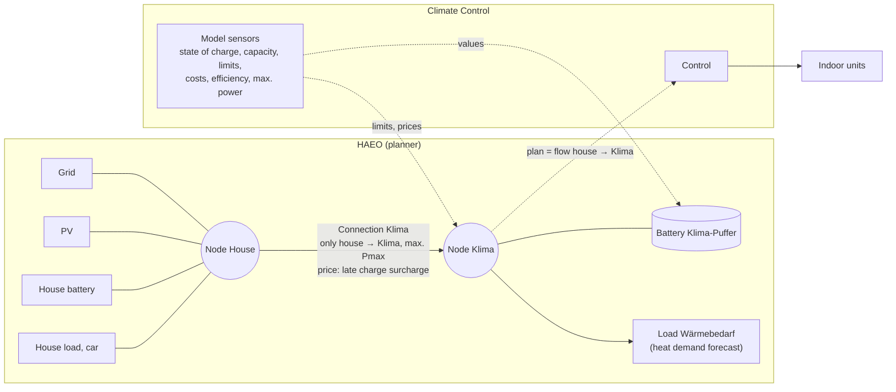
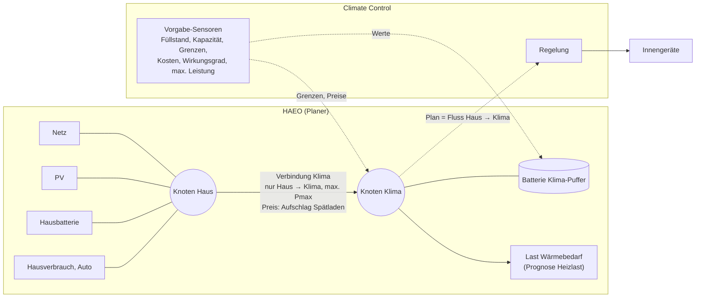

# Climate Control

**English** · [Deutsch](#deutsch)

Home Assistant integration (HACS) that makes a multi-split air conditioner usable as a thermal buffer for an
energy planner (reference: HAEO). The integration does not plan anything itself:

- It provides the planner with the buffer model (state of charge from the device temperatures, capacity,
  limits, costs, power).
- The planner decides when and with how much power to heat, e.g. directly with PV surplus during the day or
  at low prices at night instead of taking the detour via a battery.
- The integration executes this plan on the installation: it selects indoor units, modes and setpoints,
  protects the rooms (frost protection, overheating, open window) and falls back to normal heating without a plan.

Status: all decided requirements implemented and tested (unit, integration, e2e against Home Assistant
2026.10.2). Functional specification: `docs/spec/functional/`, technical: `docs/spec/technical/`.
Way of working: `AGENTS.md`.

## Setup order

Climate Control needs the plan from the planner, and the planner needs the sensors of Climate Control.
Therefore set up in this order:

1. **Install** via HACS (first button above), restart Home Assistant.
2. **Create the installation** – *Settings → Devices & services → Add integration → Climate Control*
   (or the second button above): name, Pmin, Pmax. **Leave the planner sensor empty.**
   Without a planner sensor the installation is in commissioning mode: it publishes all sensors but sends
   **no command to the indoor units** (no fallback either).
3. **Add indoor units** – in the three-dot menu (⋮) of the installation entry, *"Add indoor unit"* once per
   unit: climate entity, room name,
   setpoint (fixed value, optionally an entity such as a number helper; the fixed value is then the substitute),
   upper bound without surcharge and overload limit (room dependent, default 24 / 28 °C),
   power class, nominal power, area, optional window contact. Units can be changed or removed one by one.
4. **Set up HAEO** with the sensors of Climate Control, see [Connecting HAEO](#connecting-haeo).
5. **Connect the plan** – *Reconfigure* the installation and select the HAEO sensor with the planned power
   (`sensor.klima_power_source_target`). From now on Climate Control follows the plan.
6. Optional: **Configure** opens all parameters (thresholds, SOC, safety, planner model).

Above every non-trivial field there is a collapsible **"Help: …"** section explaining the field. The switch
**"Expand help texts when opening"** inside it decides whether all help texts are expanded the next time the
settings are opened. Several installations can be set up side by side.

The buffer capacity is not a setting. It starts at 7 kWh_el/K; learning it from operating data is planned
(concept in `docs/spec/technical/50-capacity-learning.md`).

## Connecting HAEO

The integration does not configure HAEO. It provides sensors that the HAEO elements refer to and reads the
plan back from HAEO. HAEO is set up by hand.

> Based on the HAEO documentation haeo.io/latest, checked on 22 Oct 2026. Field names may differ in older
> HAEO versions (not checked for versions before 0.5).

### Target topology

- The **battery Klima-Puffer** is the virtual heat store; its state of charge is the SOC of the worst room.
- The **load Wärmebedarf** represents the rooms cooling down. Its forecast (electrical equivalent of the heat
  demand from the weather forecast) is the planner's job and not part of this integration. Without this load
  HAEO only sees the measured SOC and keeps it constant for the future; cooling down is then not planned ahead
  but only noticed afterwards as a lower SOC.
- Battery and load hang on their own **node Klima**. Power only flows from the house to Klima (reverse 0).
  The battery can discharge into the load but cannot feed power into the house, which is physically impossible.
- **Plan:** Climate Control reads the planned **flow house → Klima**. It covers both charging the buffer and
  heating directly into the load; the battery's charge power alone would miss the direct part.

### Steps in HAEO

1. Enable **Advanced Mode** in the HAEO hub (needed for connections).
2. Create a **number helper** (`input_number`) for each fixed value: `0` (reverse direction) and `100`
   (discharge efficiency). HAEO expects helpers for constants.
3. Create **node** `Klima` (neither source nor sink).
4. Create **battery** `Klima-Puffer`, attach it to node `Klima`, enable partitions, fields as in the table below.
5. Create **load** `Wärmebedarf`, attach it to node `Klima`, forecast = sensor of the expected heat demand in kW
   (electrical).
6. Create **connection** `Klima`: source = house node, target = `Klima`.
   Max power source→target = sensor *Max charge power*, target→source = helper `0`,
   price source→target = sensor *Charge cost*.
7. Continue with step 5 of the [setup order](#setup-order).

**Optional, two power stages:** if HAEO should use the upper, less efficient power range only when it pays off,
replace connection `Klima` by two connections from the house node to `Klima`, e.g. `Klima Stufe 1` and
`Klima Stufe 2`. Their limits and the surcharge of stage 2 are pure HAEO settings (number helpers); Climate
Control does not care which stage the power comes from. Select both connection sensors as planned power in
Climate Control, they are added up.

### Sensor mapping

The sensors are called `sensor.<installation>_<name>`; entity IDs are derived from the display name in the
instance language (English names below, German in brackets).

| HAEO element and field | Climate Control sensor |
| --- | --- |
| Battery: Capacity | Capacity (Kapazität) |
| Battery: Current Charge Percentage | State of charge (Füllstand) |
| Battery: Min Charge Percentage | Min charge (Untergrenze) – area-weighted setpoint, lowered at night, with forecast |
| Battery: Max Charge Percentage | Max charge (Obergrenze) – area-weighted upper bounds without surcharge of the rooms |
| Battery: Undercharge Percentage | Undercharge (Hartes Minimum) – with forecast |
| Battery: Undercharge Cost | Undercharge cost (Strafwert Untergrenze) |
| Battery: Overcharge Percentage | Overcharge (Überlast) – area-weighted overload limits of the rooms |
| Battery: Overcharge Cost | Overcharge cost (Aufschlag Überlast) |
| Battery: Charge efficiency | Efficiency (Wirkungsgrad) |
| Battery: Discharge efficiency | helper `100` |
| Battery: Max Discharge Power | Max discharge power (Entladegrenze) |
| Battery: Max Charge Power | leave empty (limited by the connection) |
| Connection Klima: Max Power Source→Target | Max charge power (Maximale Leistung) |
| Connection Klima: Max Power Target→Source | helper `0` |
| Connection Klima: Price Source→Target | Charge cost (Aufschlag Spätladen) – falls over the horizon, with forecast |

The efficiency parameter (default 92 %) is used as charge efficiency here; the discharge efficiency stays at
100 % so that the overall efficiency equals the parameter.

### Forecasts

The sensors *Min charge*, *Undercharge* and *Charge cost* carry a `forecast` attribute as a list of
`{time, value}` with ISO 8601 timestamps. This is the custom format documented by HAEO for input sensors
(also used by e.g. template forecasts). Notes from the HAEO documentation:

- If a forecast ends before the HAEO horizon, HAEO repeats it in daily periods. Set the parameter
  **Planner forecast horizon** at least as long as the HAEO horizon, otherwise the falling late charge
  surcharge starts over after 24 h.
- HAEO averages between forecast points; the step of the night setback is therefore slightly smoothed.
- *Current Charge Percentage* only uses the current value (scalar field in HAEO).

The forecasts are part of the current state that HAEO reads; they are only excluded from the recorder
database (history) to keep it small.

### Still to check

- Whether the output sensors of HAEO connections use exactly this format. Climate Control also reads
  `start_time` and time→value mappings.
- Whether HAEO accepts the currency unit of the cost sensors (`<currency>/kWh`); the unit must match the field.
- After step 5: the Climate Control sensor *Planned power* shows the planned flow house → Klima and the coming
  hours in its `forecast` attribute; binary sensor *Fallback* is off.

## Development

1. Open the folder in VS Code, choose "Reopen in Container" (Docker required).
2. `docker compose -f .devcontainer/docker-compose.yml up -d homeassistant` (the dev container does this itself).
3. `pytest tests/unit tests/integration`, `pytest tests/performance -s`, `pytest tests/e2e`,
   then `python scripts/check_traceability.py`.
4. Regenerate: `docs/REGENERATION.md`.

---

# Climate Control (Deutsch)

[English](#climate-control) · **Deutsch**

Home-Assistant-Integration (HACS), die eine Klimaanlage mit mehreren Innengeräten für einen Energie-Planer
(Referenz: HAEO) als thermischen Puffer nutzbar macht. Die Integration plant selbst nichts:

- Sie liefert dem Planer das Modell des Puffers (Füllstand aus der Gerätetemperatur, Kapazität, Grenzen,
  Kosten, Leistung).
- Der Planer entscheidet, wann und mit welcher Leistung geheizt wird, z. B. direkt mit PV-Überschuss am Tag
  oder bei günstigen Preisen nachts statt über den Umweg Batteriespeicher.
- Die Integration setzt diesen Plan an der Anlage um: Sie wählt Innengeräte, Betriebsmodi und Sollwerte,
  schützt die Räume (Frostschutz, Überhitzung, offenes Fenster) und fällt ohne Plan auf normales Heizen zurück.

Status: alle beschlossenen Anforderungen umgesetzt und getestet (unit, integration, e2e gegen Home Assistant
2026.10.2). Fachliche Spezifikation: `docs/spec/functional/`, technische: `docs/spec/technical/`.
Arbeitsweise: `AGENTS.md`.

## Reihenfolge der Einrichtung

Climate Control braucht den Plan aus dem Planer, und der Planer braucht die Sensoren von Climate Control.
Deshalb in dieser Reihenfolge einrichten:

1. **Installieren** über HACS (erste Schaltfläche oben), Home Assistant neu starten.
2. **Anlage anlegen** – *Einstellungen → Geräte & Dienste → Integration hinzufügen → Climate Control*
   (oder zweite Schaltfläche oben): Name, Pmin, Pmax. **Planer-Sensor leer lassen.**
   Ohne Planer-Sensor ist die Anlage in Inbetriebnahme: Sie stellt alle Sensoren bereit, schickt aber
   **keinen Befehl an die Innengeräte** (auch keinen Rückfall).
3. **Innengeräte hinzufügen** – im Drei-Punkte-Menü (⋮) des Anlagen-Eintrags *„Innengerät hinzufügen“*, je Gerät
   einmal: Klimagerät,
   Raumname, Sollwert (fester Wert oder zusätzlich eine Entität wie ein Zahl-Helfer, dann ist der feste Wert der
   Ersatzwert), Obergrenze ohne Aufschlag und Überlastgrenze (raumabhängig, Standard 24 / 28 °C),
   Leistungsklasse, Nennleistung, Fläche, optional Fensterkontakt. Innengeräte lassen sich später
   einzeln ändern oder löschen.
4. **HAEO einrichten** mit den Sensoren von Climate Control, siehe [HAEO anbinden](#haeo-anbinden).
5. **Plan verbinden** – Anlage *neu konfigurieren* und den HAEO-Sensor mit der geplanten Leistung wählen
   (`sensor.klima_power_source_target`). Ab jetzt folgt Climate Control dem Plan.
6. Optional: **Konfigurieren** öffnet alle Parameter (Schwellen, SOC, Sicherheit, Planer-Modell).

Über jedem nicht trivialen Feld steht ein einklappbarer Abschnitt **„Hilfe: …“** mit der Erklärung des
Feldes. Der Schalter **„Hilfetexte beim Öffnen aufgeklappt“** im Abschnitt legt fest, ob alle Hilfetexte
beim nächsten Öffnen auf- oder zugeklappt sind. Mehrere Anlagen können nebeneinander eingerichtet werden.

Die Pufferkapazität ist keine Einstellung. Sie startet mit 7 kWh_el/K; das Lernen aus Betriebsdaten ist
geplant (Konzept in `docs/spec/technical/50-capacity-learning.md`).

## HAEO anbinden

Die Integration konfiguriert HAEO nicht selbst. Sie stellt Sensoren bereit, auf die die HAEO-Elemente
verweisen, und liest den Plan aus HAEO zurück. Die Einrichtung in HAEO erfolgt von Hand.

> Stand: HAEO-Dokumentation haeo.io/latest, geprüft am 22.10.2026. Feldnamen können in älteren
> HAEO-Versionen abweichen (ungeprüft für Versionen vor 0.5).

### Zielbild der Topologie

- Die **Batterie Klima-Puffer** ist der virtuelle Wärmespeicher; ihr Füllstand ist der SOC aus dem
  schlechtesten Raum.
- Die **Last Wärmebedarf** bildet die Auskühlung der Räume ab. Ihre Prognose (elektrisches Äquivalent der
  Heizlast aus der Wetterprognose) ist Sache des Planers und nicht Teil dieser Integration. Ohne diese Last
  sieht HAEO nur den gemessenen SOC und hält ihn für die Zukunft konstant; die Auskühlung wird dann nicht
  vorausgeplant, sondern erst nachträglich am gesunkenen SOC sichtbar.
- Batterie und Last hängen am eigenen **Knoten Klima**. Strom fließt nur vom Haus zum Klima (Rückrichtung 0).
  Die Batterie kann sich so in die Last entladen, aber keinen Strom ins Haus speisen, was physikalisch auch
  nicht geht.
- **Plan:** Climate Control liest den geplanten **Fluss Haus → Klima**. Er umfasst Laden des Puffers und
  direktes Heizen in die Last; die Ladeleistung der Batterie allein würde den direkten Anteil nicht enthalten.

### Schritte in HAEO

1. Im HAEO-Hub den **Advanced Mode** einschalten (nötig für Verbindungen).
2. Für feste Werte je einen **Helfer „Zahl“** (`input_number`) anlegen: `0` (Rückrichtung) und `100`
   (Entlade-Wirkungsgrad). HAEO erwartet für Konstanten Helfer.
3. **Knoten** `Klima` anlegen (weder Quelle noch Senke).
4. **Batterie** `Klima-Puffer` anlegen, an den Knoten `Klima` anschließen, Partitionen einschalten,
   Felder laut Tabelle unten.
5. **Last** `Wärmebedarf` anlegen, an den Knoten `Klima` anschließen, Prognose = Sensor der erwarteten
   Heizlast in kW (elektrisch).
6. **Verbindung** `Klima`: Quelle = Hausknoten, Ziel = `Klima`.
   Max. Leistung Quelle→Ziel = Sensor *Maximale Leistung*, Ziel→Quelle = Helfer `0`,
   Preis Quelle→Ziel = Sensor *Aufschlag Spätladen*.
7. Weiter mit Schritt 5 der [Reihenfolge der Einrichtung](#reihenfolge-der-einrichtung).

**Optional, zwei Leistungsstufen:** Soll HAEO den oberen, weniger effizienten Leistungsbereich nur nutzen,
wenn es sich lohnt, die Verbindung `Klima` durch zwei Verbindungen vom Hausknoten zu `Klima` ersetzen, z. B.
`Klima Stufe 1` und `Klima Stufe 2`. Deren Grenzen und der Aufschlag der Stufe 2 sind reine HAEO-Einstellungen
(Zahl-Helfer); Climate Control ist egal, aus welcher Stufe die Leistung kommt. In Climate Control beide
Verbindungssensoren als geplante Leistung wählen, sie werden addiert.

### Zuordnung der Sensoren

Die Sensoren heißen `sensor.<anlage>_<name>`; die Entitäts-IDs entstehen aus dem Anzeigenamen in der
Sprache der Instanz (unten deutscher Name, in Klammern der englische).

| HAEO-Element und Feld | Sensor von Climate Control |
| --- | --- |
| Batterie: Capacity | Kapazität (Capacity) |
| Batterie: Current Charge Percentage | Füllstand (State of charge) |
| Batterie: Min Charge Percentage | Untergrenze (Min charge) – flächengewichteter Sollwert, nachts abgesenkt, mit Prognose |
| Batterie: Max Charge Percentage | Obergrenze (Max charge) – flächengewichtete Obergrenzen ohne Aufschlag der Räume |
| Batterie: Undercharge Percentage | Hartes Minimum (Undercharge) – mit Prognose |
| Batterie: Undercharge Cost | Strafwert Untergrenze (Undercharge cost) |
| Batterie: Overcharge Percentage | Überlast (Overcharge) – flächengewichtete Überlastgrenzen der Räume |
| Batterie: Overcharge Cost | Aufschlag Überlast (Overcharge cost) |
| Batterie: Charge efficiency | Wirkungsgrad (Efficiency) |
| Batterie: Discharge efficiency | Helfer `100` |
| Batterie: Max Discharge Power | Entladegrenze (Max discharge power) |
| Batterie: Max Charge Power | leer lassen (begrenzt durch die Verbindung) |
| Verbindung Klima: Max Power Source→Target | Maximale Leistung (Max charge power) |
| Verbindung Klima: Max Power Target→Source | Helfer `0` |
| Verbindung Klima: Price Source→Target | Aufschlag Spätladen (Charge cost) – fällt über den Horizont, mit Prognose |

Der Wirkungsgrad aus den Parametern (Standard 92 %) gilt hier als Lade-Wirkungsgrad, der Entlade-Wirkungsgrad
bleibt bei 100 %, damit der Gesamtwirkungsgrad dem Parameter entspricht.

### Prognosen

Die Sensoren *Untergrenze*, *Hartes Minimum* und *Aufschlag Spätladen* tragen ein Attribut `forecast` als
Liste aus `{time, value}` mit Zeitstempeln nach ISO 8601. Das ist das von HAEO für Eingangssensoren
dokumentierte eigene Format (das z. B. auch Template-Forecasts verwenden). Hinweise aus der HAEO-Doku:

- Endet eine Prognose vor dem HAEO-Horizont, wiederholt HAEO sie im Tagesrhythmus. Den Parameter
  **Prognosehorizont für den Planer** daher mindestens so lang wie den HAEO-Horizont setzen, sonst beginnt
  der fallende Aufschlag Spätladen nach 24 h von vorn.
- HAEO mittelt zwischen den Prognosepunkten; der Sprung der Nachtabsenkung wird dadurch leicht geglättet.
- *Current Charge Percentage* verwendet nur den aktuellen Wert (skalares Feld in HAEO).

Die Prognosen gehören zum aktuellen Zustand, den HAEO liest; nur in der Recorder-Datenbank (Verlauf) werden sie
nicht gespeichert, damit diese klein bleibt.

### Noch zu prüfen

- Ob die Ausgabesensoren der HAEO-Verbindungen genau dieses Format haben. Climate Control liest auch
  `start_time` und Zeit→Wert-Abbildungen.
- Ob HAEO die Währungseinheit der Kostensensoren (`<Währung>/kWh`) akzeptiert; die Einheit muss zum Feld passen.
- Nach Schritt 5: Sensor *Geplante Leistung* von Climate Control zeigt den geplanten Fluss Haus → Klima und
  im Attribut `forecast` die kommenden Stunden; Binärsensor *Rückfall* ist aus.

## Entwicklung

1. Ordner in VS Code öffnen, „Reopen in Container“ wählen (Docker nötig).
2. `docker compose -f .devcontainer/docker-compose.yml up -d homeassistant` (startet der Devcontainer selbst).
3. `pytest tests/unit tests/integration`, `pytest tests/performance -s`, `pytest tests/e2e`,
   danach `python scripts/check_traceability.py`.
4. Neu generieren: `docs/REGENERATION.md`.
